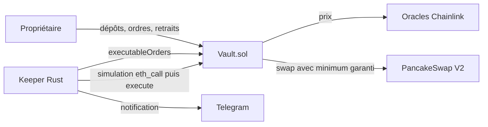

# Bastion

**Coffre DeFi personnel qui exécute automatiquement mes ordres de trading sur BNB Chain : DCA, ordres limites, stop-loss et take-profit.**

Les fonds restent dans un smart contract dont je suis le seul propriétaire. Un robot (le *keeper*) déclenche les ordres quand leurs conditions sont remplies, mais il ne peut jamais retirer les fonds ni échanger à un mauvais prix.


> ⚠️ Projet personnel non audité. À utiliser sur testnet, sur un fork local, ou avec de petites sommes.

## Stratégies

| Ordre | Déclencheur | Exemple |
| --- | --- | --- |
| **DCA** | Toutes les `interval` secondes, `n` fois | 100 USDT → BNB chaque semaine, 10 fois |
| **Ordre limite (achat)** | Prix ≤ cible | Acheter du BNB si le prix passe sous 500 $ |
| **Stop-loss** | Prix ≤ cible | Vendre mon BNB s'il passe sous 450 $ |
| **Take-profit / limite (vente)** | Prix ≥ cible | Vendre mon BNB s'il dépasse 800 $ |

## Modèle de sécurité

| Rôle | Peut | Ne peut pas |
| --- | --- | --- |
| **Propriétaire** | Déposer, retirer, créer et annuler des ordres, changer de keeper, mettre en pause | — |
| **Keeper** | Appeler `execute(id)` quand la condition est remplie | Retirer, créer ou modifier un ordre, changer la configuration |

Les protections du contrat ([`contracts/src/Vault.sol`](contracts/src/Vault.sol)) :

- **Prix par oracle Chainlink**, jamais par le pool : le montant minimum reçu est calculé à partir du prix Chainlink moins la tolérance choisie (10 % maximum). Un pool manipulé (attaque sandwich, flash loan) fait échouer l'échange au lieu de faire perdre des fonds.
- **Double vérification** : le contrat mesure lui-même ce qu'il a reçu, sans se fier à la réponse du router.
- **Prix périmés refusés** : un âge maximal est fixé pour chaque oracle.
- **Bonnes pratiques** : `checks-effects-interactions`, `ReentrancyGuard`, `SafeERC20`, approbation remise à zéro après chaque échange, transfert de propriété en deux étapes, pause d'urgence.

## Architecture



```
contracts/   Foundry : Vault.sol, interfaces, mocks, tests, scripts de déploiement
keeper/      Robot Rust (alloy) : lit les ordres prêts, simule, envoie, notifie
scripts/     Test de bout en bout (anvil + contrat + keeper)
```

Le keeper **simule chaque transaction avant de l'envoyer** : il ne paie jamais de gas pour une transaction qui échouerait, et il traduit les erreurs du contrat en messages lisibles (« prix de l'oracle périmé », « solde insuffisant »…). Il refuse aussi d'envoyer si le prix du gas dépasse une limite.

## Tests

```bash
cd contracts && forge test     # 29 tests : unitaires, fuzzing et invariants
cd keeper && cargo test        # décodage des erreurs, formatage
./scripts/e2e.sh               # chaîne locale + contrat + keeper réel
```

- **Tests unitaires** : droits d'accès, validation des ordres, chaque stratégie, oracle périmé ou invalide, pause, routage via WBNB.
- **Fuzzing** : le minimum garanti correspond toujours à la valeur oracle moins la tolérance, et une exécution n'est jamais pire que la tolérance, quelle que soit la qualité du pool.
- **Invariants** (8 000 appels aléatoires par campagne : keeper, temps, prix, pool manipulé, router malhonnête) :
  - le keeper ne reçoit jamais de fonds ;
  - aucune exécution ne dépasse la tolérance de prix ;
  - un ordre ne s'exécute jamais plus de fois que prévu ;
  - aucune approbation ne reste ouverte vers le router.
- **Bout en bout** : déploiement sur anvil, puis le keeper Rust exécute le DCA, ignore l'ordre limite non déclenché et refuse un wallet qui n'est pas le keeper.

## Utilisation

### 1. Déployer le coffre

```bash
cd contracts
cast wallet import deployer --interactive        # clé chiffrée, jamais en clair

ROUTER=0x... WRAPPED_NATIVE=0x... KEEPER=0xADRESSE_DU_KEEPER \
FEED_TOKENS=0xWBNB,0xUSDT FEED_AGGREGATORS=0xFEED_BNB_USD,0xFEED_USDT_USD \
forge script script/Deploy.s.sol --rpc-url $RPC_URL --account deployer --broadcast
```

Les adresses du router PancakeSwap, du WBNB et des oracles Chainlink dépendent du réseau. Vérifiez-les dans la documentation officielle de PancakeSwap et de Chainlink (*Data Feeds*, BNB Chain).

> Astuce : pour tester avec les vrais pools et les vrais oracles sans dépenser un centime, lancez un fork local du mainnet avec `anvil --fork-url <RPC BSC mainnet>` et déployez dessus. Sur le testnet, les prix des pools PancakeSwap ne suivent pas ceux de Chainlink, donc la protection contre le slippage y fait échouer les échanges.

### 2. Créer des ordres

```bash
# Approvisionner le coffre en USDT, puis : 100 USDT → WBNB chaque semaine, 10 fois, 1 % de tolérance
cast send $VAULT "createDca(address,address,uint128,uint32,uint32,uint16)" \
  $USDT $WBNB 100000000000000000000 604800 10 100 --account deployer --rpc-url $RPC_URL
```

### 3. Lancer le keeper

```bash
cd keeper
cp .env.example .env       # RPC_URL, VAULT_ADDRESS, KEEPER_PRIVATE_KEY (wallet dédié avec un peu de BNB pour le gas)
cargo run --release        # tourne en continu
cargo run --release -- once  # un seul passage
DRY_RUN=true cargo run --release -- once  # simule sans rien envoyer, sans clé
```

## Feuille de route

- [ ] Interface web pour créer et suivre les ordres (Next.js + wagmi)
- [ ] Protection contre les tokens à risque grâce au score de [RugRadar](https://github.com/adlanehzx/rugradar)
- [ ] Support de PancakeSwap V3
- [ ] Ordres « trailing stop »

## Licence

[MIT](LICENSE) © Adlane Hamzaoui
