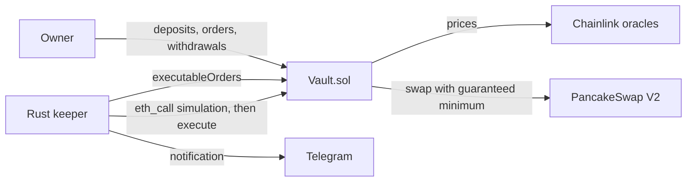

# Bastion

**A personal DeFi vault that automatically executes my trading orders on BNB Chain: DCA, limit orders, stop-loss and take-profit.**

Funds stay in a smart contract that only I own. A bot (the *keeper*) triggers orders when their conditions are met, but it can never withdraw funds or swap at a bad price.


> ⚠️ Unaudited personal project. Use it on testnet, on a local fork, or with small amounts only.

## Strategies

| Order | Trigger | Example |
| --- | --- | --- |
| **DCA** | Every `interval` seconds, `n` times | 100 USDT → BNB every week, 10 times |
| **Limit order (buy)** | Price ≤ target | Buy BNB if the price drops below $500 |
| **Stop-loss** | Price ≤ target | Sell my BNB if it drops below $450 |
| **Take-profit / limit (sell)** | Price ≥ target | Sell my BNB if it rises above $800 |

## Security model

| Role | Can | Cannot |
| --- | --- | --- |
| **Owner** | Deposit, withdraw, create and cancel orders, change keeper, pause | — |
| **Keeper** | Call `execute(id)` once the condition is met | Withdraw, create or modify an order, change the configuration |

Contract protections ([`contracts/src/Vault.sol`](contracts/src/Vault.sol)):

- **Prices come from a Chainlink oracle**, never from the pool: the minimum amount received is computed from the Chainlink price minus the chosen tolerance (10 % at most). A manipulated pool (sandwich attack, flash loan) makes the swap fail instead of losing funds.
- **Double check**: the contract measures what it actually received itself, without trusting the router's response.
- **Stale prices are rejected**: a maximum age is set for each oracle.
- **Best practices**: `checks-effects-interactions`, `ReentrancyGuard`, `SafeERC20`, approval reset to zero after every swap, two-step ownership transfer, emergency pause.

## Architecture



```
contracts/   Foundry: Vault.sol, interfaces, mocks, tests, deployment scripts
keeper/      Rust bot (alloy): reads ready orders, simulates, sends, notifies
scripts/     End-to-end test (anvil + contract + keeper)
```

The keeper **simulates every transaction before sending it**: it never pays gas for a transaction that would fail, and it turns contract errors into readable messages ("stale oracle price", "insufficient balance"…). It also refuses to send when the gas price exceeds a limit.

## Tests

```bash
cd contracts && forge test     # 29 tests: unit, fuzzing and invariants
cd keeper && cargo test        # error decoding, formatting
./scripts/e2e.sh               # local chain + contract + real keeper
```

- **Unit tests**: access control, order validation, each strategy, stale or invalid oracle, pause, routing through WBNB.
- **Fuzzing**: the guaranteed minimum always equals the oracle value minus the tolerance, and an execution is never worse than the tolerance, whatever the pool quality.
- **Invariants** (8,000 random calls per campaign: keeper, time, prices, manipulated pool, dishonest router):
  - the keeper never receives funds;
  - no execution exceeds the price tolerance;
  - an order never executes more times than planned;
  - no approval stays open towards the router.
- **End to end**: deployment on anvil, then the Rust keeper executes the DCA, skips the limit order that has not triggered, and rejects a wallet that is not the keeper.

## Usage

### 1. Deploy the vault

```bash
cd contracts
cast wallet import deployer --interactive        # encrypted key, never in plain text

ROUTER=0x... WRAPPED_NATIVE=0x... KEEPER=0xKEEPER_ADDRESS \
FEED_TOKENS=0xWBNB,0xUSDT FEED_AGGREGATORS=0xFEED_BNB_USD,0xFEED_USDT_USD \
forge script script/Deploy.s.sol --rpc-url $RPC_URL --account deployer --broadcast
```

The PancakeSwap router, WBNB and Chainlink oracle addresses depend on the network. Check them in the official PancakeSwap and Chainlink documentation (*Data Feeds*, BNB Chain).

> Tip: to test with real pools and real oracles without spending a cent, start a local mainnet fork with `anvil --fork-url <BSC mainnet RPC>` and deploy on it. On testnet, PancakeSwap pool prices do not track Chainlink's, so the slippage protection makes swaps fail there.

### 2. Create orders

```bash
# Fund the vault with USDT, then: 100 USDT → WBNB every week, 10 times, 1 % tolerance
cast send $VAULT "createDca(address,address,uint128,uint32,uint32,uint16)" \
  $USDT $WBNB 100000000000000000000 604800 10 100 --account deployer --rpc-url $RPC_URL
```

### 3. Run the keeper

```bash
cd keeper
cp .env.example .env       # RPC_URL, VAULT_ADDRESS, KEEPER_PRIVATE_KEY (dedicated wallet with a little BNB for gas)
cargo run --release        # runs continuously
cargo run --release -- once  # a single pass
DRY_RUN=true cargo run --release -- once  # simulates without sending anything, no key needed
```

## Roadmap

- [ ] Web interface to create and track orders (Next.js + wagmi)
- [ ] Protection against risky tokens using the [RugRadar](https://github.com/adlanehzx/rugradar) score
- [ ] PancakeSwap V3 support
- [ ] Trailing-stop orders

## License

[MIT](LICENSE) © Adlane Hamzaoui
